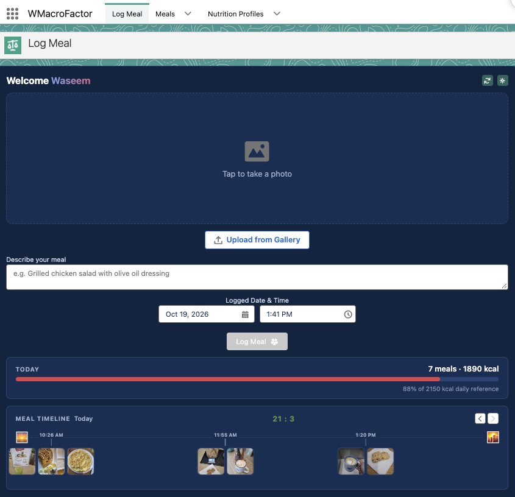
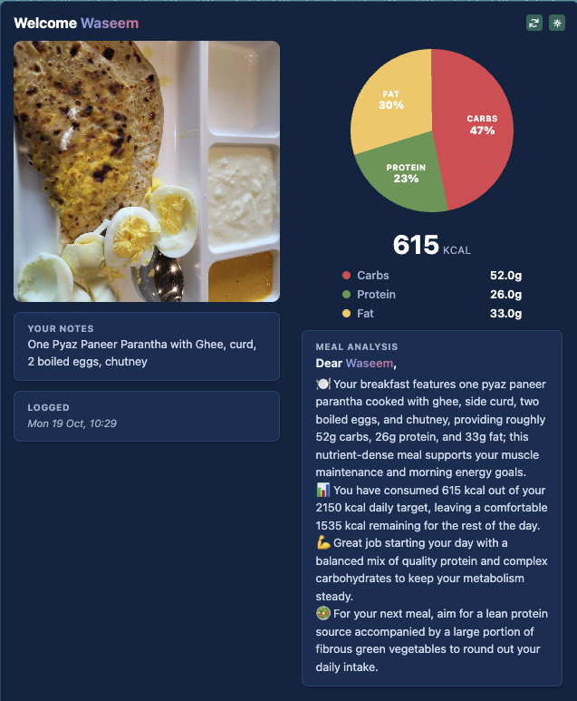
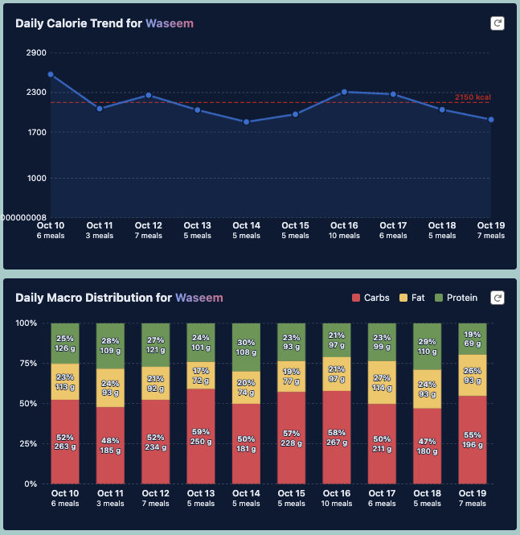

# WMacroFactor APP

WMacroFactor App is an AI-assisted Diet Coach that helps in keeping track of your meal intake and trends. Stay Conscious of your macros!

## App Highlights

This Desktop & Mobile Salesforce App logs your recorded Meals, sends the image to Gemini for meal analysis, and reports on your Daily Caloric Intake and breaks down your macros - fats, carbohydrates, protein for detailed reporting.





- Create Nutrition Profile per User with their Gender, Age, BMI details and input daily caloric threshold to target
- Log Meals for that user by either taking a photo from mobile camera or upload image from gallery
- App sends your Image to Gemini AI via API and gets it analyzed and breaks down your macros for each meal along with AI observations and Diet coach recommendations
- Line chart shows your Daily caloric intake aggregated per day with a base reference line of your nutrition profile's caloric threshold
- Stacked Bar chart shows your overall macros consumed for all meals aggregated per day

The app also features - a scheduled reminder (email + notification) to the Nutrition Profiles to log their meals in WMacroFactor app , an automatic retry mechanism to call Gemini and analyze the pending meals if any, and a File Delete background Job that deletes the historic meal images and free up storage space in your org.

---


## Pre-Installation Steps

Go to Gemini Studio and Create Your Own ```Gemini API KEY```
This will need to be updated in the Named Credential post-installation and is essential for the app to make callouts to Gemini.
The package calls model `gemini-3.5-flash-lite` at `https://generativelanguage.googleapis.com`. Have your own key ready; do not reuse a key from another org.


## How to Install 

Login to your Own Dev Org / Trailhead Playground / Production instance. 
First Follow the pre-installation steps, then Install the app's Unmanaged package using below link -
[Version 1.1](https://login.salesforce.com/packaging/installPackage.apexp?p0=04tak000000oqQ1)

And then Follow the post-installation steps below


## Post-Installation Steps

As a System Admin, kindly assign yourself the Permission Set **WMacroFactor User**

### 1. Set the Gemini API key
The API key is sent in the `x-goog-api-key` header configured on the **WMF Gemini** Named Credential.
- Setup → *Named Credentials* → **WMF Gemini** → edit the `x-goog-api-key` header value and enter **your own key here**.
- Confirm the External Credential **WMF Gemini Credential** has its `GeminiKey` principal, and that `WMacroFactor User` permission set grants access to it.

> **Security:** a key stored as a plain header value is visible to admins and is exported with this metadata. Never commit or package a live key. Use a restricted key, and consider moving it into the External Credential as a secret and referencing it with a merge field in the header.

### 2. Create Users and Grant access & Create Nutrition Profiles
- Beyond your own System Admin User, if you wish to create more users, then you should first create a Profile -  (Salesforce License) OR (Salesforce Platform License) Profile - depending on your license limits and then assign the newly created users the **WMacroFactor User** permission set.
- Ensure Your Profile grants Read access to the Object **User External Credentials**  , alongside granting "Lightning Experience User" and "API Enabled" user.
- Now in the WMacroFactor app, Create Nutritional Profile record per User (state gender, date of birth, height, weight,Daily Caloric Threshold) to enable them to view the app, and start logging meals for their Nutritional profile.

### 3. Verify the flows are Active
Setup → *Flows*: `WMF Meal Reminder Scheduler`, `WMF Re-Analyze Meal` and `WMF Remind Now` should all be **Active**. Activate them if not.

### 5. Schedule 3 background jobs
Scheduled Apex is not metadata and does not travel with a package. Run once in **Anonymous Apex** (Developer Console → Debug → Open Execute Anonymous Window):

```
WMF_MealRetrySweep.reschedule();          // Meal retry sweep to auto-retry failed Gemini callouts. retries "Analysis Pending" meals, every ~20 min (3 jobs)
WMF_MealImagePurge.scheduleDaily();       // Delete old photos (ContentDocument Files) of Analyzed meals and free up storage, daily 02:00
WMF_MealReminderBatch.scheduleHourly();   // OPTIONAL: scheduled reminders to users to log their meals Remind them in 15 hours from last logged meal. Runs every 2 hours (12 jobs)
```

- The reminder batch is optional: the `WMF Meal Reminder Scheduler` flow already sends reminders 15 hours after each meal, and a profile already reminded for a meal cycle is skipped.
- Re-running `reschedule()` or `scheduleHourly()` replaces their own jobs. `scheduleDaily()` errors if the job already exists.
- Check: Setup → *Scheduled Jobs*.

### 6. Check file and email settings
- Ensure Setup-> Email Deliverability is set to All Email
- The first reminder email creates a public link for the app image (`W_MacroFactor_App_logo`) automatically. If your org blocks public file links, the email still sends but the header shows text only.
- Send yourself a test: open a Nutrition Profile (whose User has an email) and click **Remind Now**. You should get the email (subject *"🍽️ Did you Log your Meal yet ?"*) and a bell notification.

---

### Deployment

If you are unable to Install [this Unmanaged Package](https://login.salesforce.com/packaging/installPackage.apexp?p0=04tak000000oqQ1), then you can manually deploy the contents of this repository in your Developer Edition Org or a Sandbox-

1. Clone this repository in your local machine:

    ```
    git https://github.com/WaseemAliSabeel/WMacroFactor
    cd WMacroFactor
    ```

2. Authorize your org and provide it with an alias (example **yourdevorg** in the command below):

    ```
    sf org login web --alias <yourdevorg>
    ```

3. Run this command in a terminal to deploy this app in your Org

    ```
    sf project deploy start --manifest manifest/package.xml --target-org <yourdevorg> --test-level RunLocalTests
    ```

4. Post deployment, you can configure the Named Credential with your API Key, grant yourself the "WMacroFactor User" Permission Set , create Your Nutrition Profile record for Your User and start logging your meals !

---

## Authors

* **Waseem Ali Sabeel** -  - [@WaseemAliSabeel](https://github.com/WaseemAliSabeel) :cowboy_hat_face:

---


## License

This project is licensed under the MIT License - see the [LICENSE.md](LICENSE.md) file for details
- **[MIT license](http://opensource.org/licenses/mit-license.php)**
